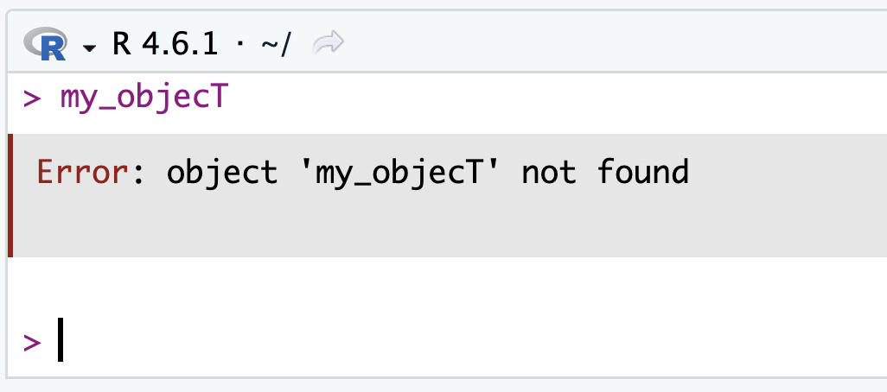
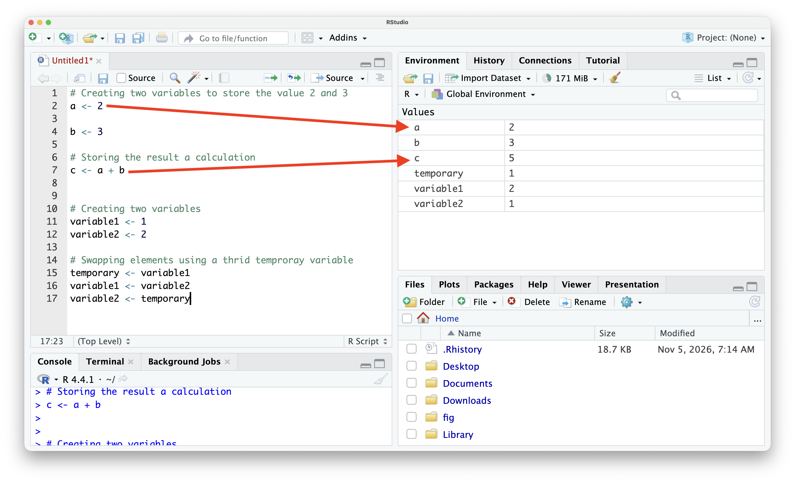

# Variable assigment {#sec-assignment}



::: {style="margin-top: 1em; font-size: 125%; font-weight: 1000; text-align: center;"}
Trinite
:::

`sary_mainitirano.jpeg`, `foza orana.mp3`, `Malok'ila_1.mp4`. Beyond clicking these files on a computer, consider how they actually work. [Note: Replaced "foza orana.mp3" with "foza_orana.mp3" to prevent issues with spaces in filenames, and removed the second-person pronoun "you".]

Suppose a filename is changed (renamed), for example: `sary_maintirano.jpeg` to `sary_paris.jpeg`. When opened, the image remains the photo taken in Maintirano. In other words, a filename is something symbolic—a label created by the user to indicate the content. It can be frustrating to find a file with no indication of its contents unless it is opened.

Fundamentally, file content is a sequence of 0s and 1s stored in the computer's memory. To access this sequence, the address (the location of that sequence) is required. Figuratively, the filename is like the name of a house (e.g., Villa Fanomezana); the name can change, but the physical house and its address generally remain the same.

In programming, an assignment consists of binding three elements: creating an object (building a house) at a specific location (the address) and assigning it a chosen label. While one can choose what object to create and what to name it, the address itself (where it is placed in computer memory) is determined by the system—which is ultimately for the best.


## Formal {.unnumbered}

In programming language design, assignment is defined as a mechanism that dynamically changes the binding between a storage location and a value. It introduces the foundational concepts of L-values (location/address) and R-values (read/data value).

In R, the syntax is:
`variablename <- object`{.r} which reads: put the object in memory and assign it a name. The assignment operator essentially creates a new variable name, allocates an address, and stores the created object there.

An object can be almost anything; in fact, the rest of this section covers the different types of fundamental objects, from @sec-numeric to @sec-list.

## Examples {.unnumbered}


**Assignment and console output**
```{r}
#| echo: true

# Store the number(object) 2 in variable called a.
a <- 2
```

In the first example above, the number (object/value) `2` is stored in a variable called `a`. Running that line in R produces no output in the console, because the instruction is to create the object, not to evaluate it.

```{r}
# this will display the value stored in a
a
```

**Adding numbers two numbers using their names** Instead of calculating `2 + 3` directly, 2 can be stored in `a` and 3 in `b`. Then, `a + b` can be added and stored in `c`.
Notice again that variable names are symbolic.

```{r}
#| echo: true

# Creating two variables to store the value 2 and 3
a <- 2

b <- 3

# Storing the result of the calculation
c <- a + b
```


**Swapping values**: A very instructive exercise for understanding assignment is swapping the contents of two variables.

```{r}
#| echo: true

# Swapping elements between box
variable1 <- 1
variable2 <- 2

variable2 <- variable1
variable1 <- variable2
```


```{r}
# Print what is the value in variable1
variable1
# Print what is the value in variable2
variable2
```

It does not work: the value inside variable1 becomes 1 (no swap occurs), and variable2 also becomes 1. The solution is similar to swapping juice in a cup and coffee in a glass: to swap the contents, one must first transfer one of the beverages into a third container before proceeding.

```{r}
#| echo: true

# Creating two variables
variable1 <- 1
variable2 <- 2

# Swapping elements using a thrid temproray variable
temporary <- variable1
variable1 <- variable2
variable2 <- temporary
```

```{r}
# Print the values in both variables
variable1
variable2
```
The values are swapped.

## Tips and warnings {.unnumbered}

- The default shortcut for `<-` in RStudio on Windows is Alt + - and Option + - on Mac.

- Object names are case-sensitive.
  - `my_variable <- 2`{.r},
  - `my_Variable <- 2`{.r},
  - `my_varable <- 2`{.r}

are three different objects with different addresses and different variable names.

- The most common error in programming is shown below @fig-objectError. While it can cause panic, it is the easiest to solve, and the main culprits are:
 - Typos: case sensitivity, spelling etc.
 -  Unassigned variables, where code was typed in the script but not executed, so the object is not stored in the environment

{#fig-objectError width="60%"}


- In R, `=` can also be used for object assignment (`a = 2`{.r} works as well). However, `<-` is preferred to be explicit, reserving `=` for specific contexts such as passing arguments inside functions.

- The rightward assignment operator `->` is also supported (`2 -> a`{.r}).

- In the code below, an existing value can be overwritten and lost. See the swapping exercise above.

- Creating evocative variable names is a good habit so the content can easily be inferred.

- Variable naming conventions:
  - No spaces or special characters (`%`, `$`, etc.)
  - Cannot start with a number or an underscore
  - Multi-word conventions:
    - TelmaNumber and MadacomNumber (PascalCase)
    - telmaNumber and madacomNumber (camelCase)
    - telma_number and madacom_number (snake_case)
    - TELMA_NUMBER and MADACOM_NUMBER (screaming snake_case)
    - telma.number and madacom.number (informal dot.case)

-  After evaluation, the top-right panel shows all created objects, along with their names and values.

{#fig-RstudioAssignment}


### Notation/Semantic/Terminology {.unnumbered}

Semantic: variable name

The notion of variable has now appeared in three field: in mathematics, in statistics @sec-variable, and also in R. In fact the variable name is also called a variable. Obviously, it does not mean the same thing. This is inevitable in three flourishing field that have some similarities. Yet, it is a good exercise to see the nuances.