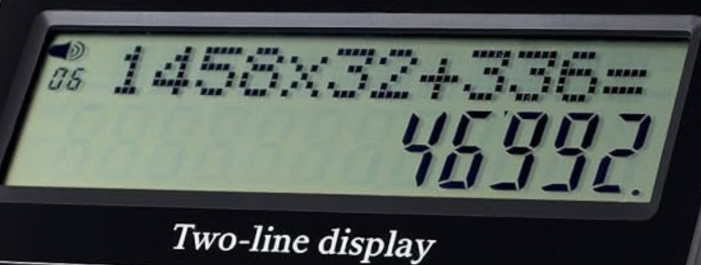
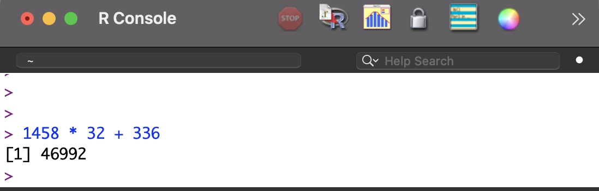
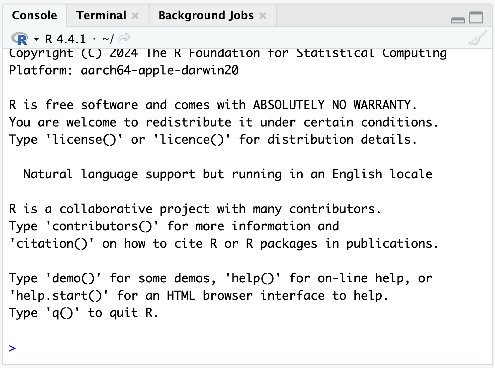
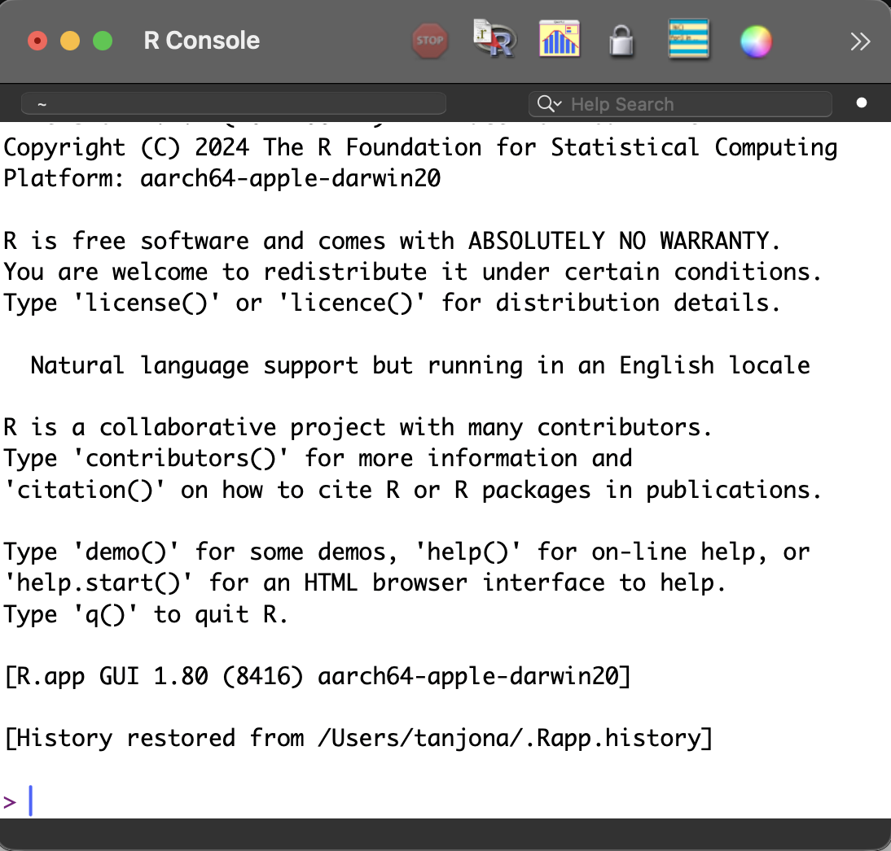
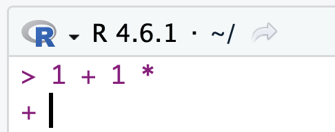

# Console {#sec-console}



::: {style="margin-top: 1em; font-size: 125%; font-weight: 1000; text-align: center;"}
Ecran'na calculatrice
:::

Everyone knows how to use a calculator:

1. you type an arithmetic operation (prompt)
2. you press = (to execute)
3. the result is displayed (output)

With the most basic calculator, it shows the calculation (top line) as well as the result @fig-basic_cal. This is a useful addded feature so you can make sure you entered the correct operation.

::: {#fig-calculator layout-ncol=2}

{#fig-basic_cal}

{#fig-console}

Same concept, different interface.
:::

A console functions exactly like a calculator @fig-console:

1. Type your operation after the ">" symbol.
2. Press enter/return to evaluate
3. The result is displayed under the prompt.

Notice that result is displaed a bit differently (color, not after >). And also a new > apperas indivading that it is waiting for a new

In a conceptual way, the console is the interface that displays your communication with the program. Shows your input and displays the output. This simple interface is common to almost all programs.

## Formal {.unnumbered}
For a program to run, there are four components: the terminal, console, shell, and kernel

[geeklink](https://www.geeksforgeeks.org/operating-systems/what-is-terminal-console-shell-and-kernel/)

base: The core language syntax, math (sum, log), and logic (if, for).
stats: Traditional statistical calculations, distributions, and models (lm, glm, sd, rnorm).
graphics: The original plotting engine (plot, hist, barplot).
utils: Utility tools for data import and system management (read.csv, install.packages, head).
grDevices: Colors and font support for plotting.

## Examples {.unnumbered}
See below interface of three consoles using base R,  in RStudio, and in VS Code.

::: {#fig-Rconsole layout-nrow=3}

{#fig-console_default width=300}

{#fig-console_rstudio width=300}

{#fig-console_vscode width=300}

Same concept
:::

As an exercice, you can open R or RStudio and try to input the command below, the code is in gray and you should see the output as black after you execute. While you can use copy/paste to do this. It is highly recommended that you enter the text manually. C

```{r}
#| echo: true

1 + 1 * 4.1
```

```{r}
#| echo: true

sin(123)
```

```{r}
#| echo: true

cat("Hello world")
print("Hello world")
```

## Tips and warnings {.unnumbered}
- Semantic: Commandline interface, terminal, console moslty mean the same thing.
- Semantic: script, prompt, code, commands are synonymous. It is essentially means the collection of instructions that you want the programs to evaluate
- Unlike a calculator, you don't write your prompt in the (see next @sec-ide)
- You cannot modify evaluated prompt.
- Your prompt can be incomplete, the program cannot get the answer and is asking you to add more input to run the (+) as well as a blinking black cursor.

{#fig-incomplete width = 100}
 In that case, you can
  - complete the like adding say the number you want to multiply
  - escape the expectation by typing escape key (esc)
- Mouse is useless in the console. It is meant to work with keyboard,
- It is not recommended to write prompt on the console...it is simple but and a different window called script  is dedicated to writing code (see @sec-ide).
- When you open the R, or RStudio, you can see the version of the program you are using and other licensing information (see @fig-console_rstudio)
- If you close the console/program, all the booking is lost. You can save it as what it is called "Workspace", but it is not recommended.
<!--
Check this: In general, it is also called a terminal on macOS, command prompt in windows, Bash/Zsh on Linux.


The interface is a bit different but it is the same thing. The console however has more features.

- The display records of  the command you add.
- After the evaluation, the ">" appears below indicating that the console is waiting for your next prompt
- Your prompt can be as long as you want, lisibility is the limit
- It does more than simple arithmetic operation -->

<!-- ## If you want to know more {.unnumbered} -->