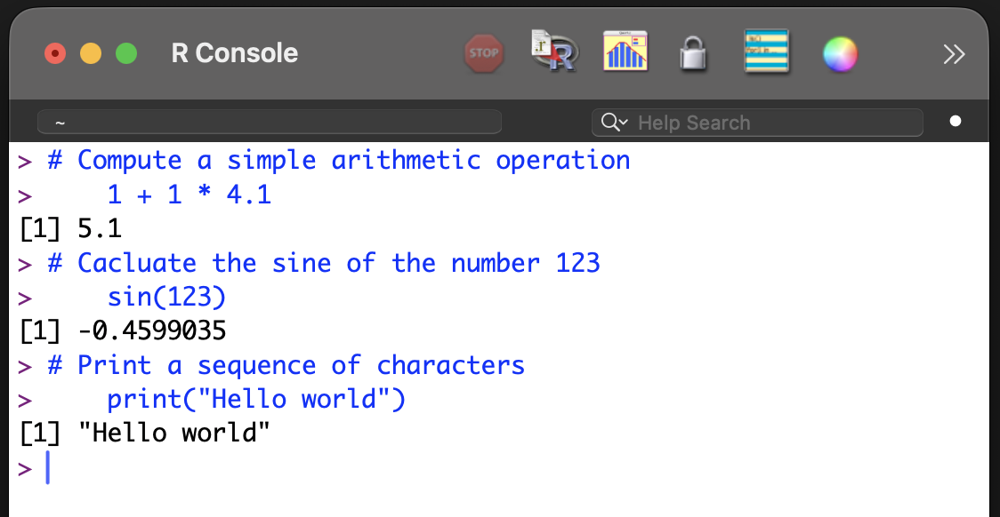
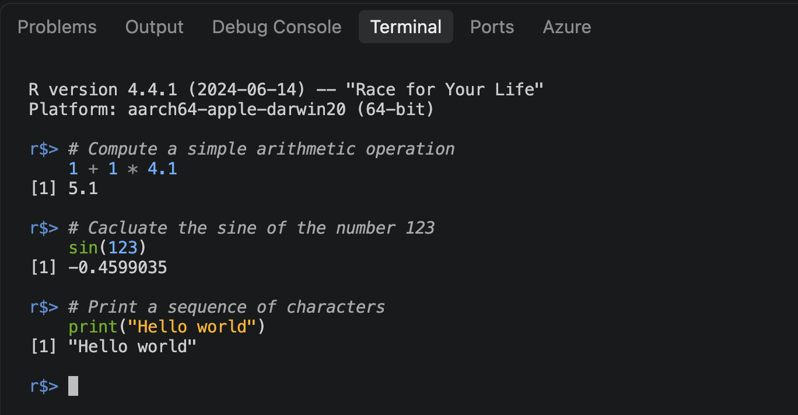
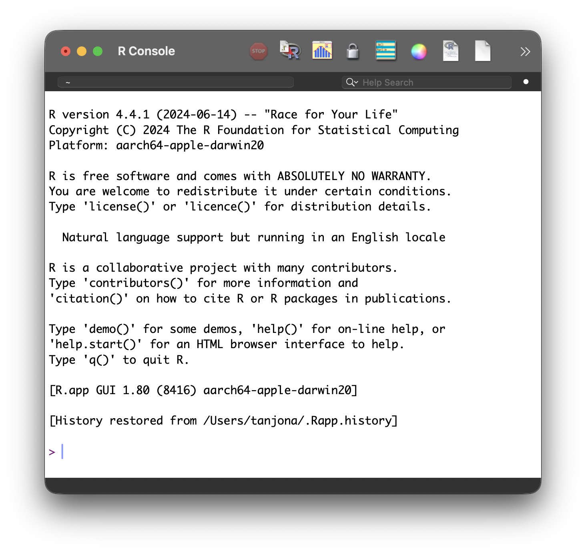
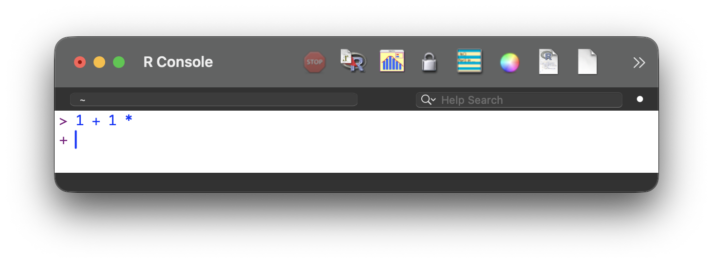

# Console {#sec-console}



::: {style="margin-top: 1em; font-size: 125%; font-weight: 1000; text-align: center;"}
Ecran'na calculatrice
:::


Everyone knows how to use a calculator:

1. Type an arithmetic operation (prompt).
2. Press = (to execute).
3. The result is displayed (output).

With most basic calculators, the display shows both the calculation (top line, this is a useful added feature to ensure the correct operation was entered) and the result @fig-basic_cal.

::: {#fig-calculator layout-ncol=2}

{#fig-basic_cal}

{#fig-console}

Same concept, different interface.
:::

A console functions exactly like the interface of a calculator @fig-console:

1. Type the operation after the ">" symbol.
2. Press enter to evaluate.
3. The result is displayed under the prompt.


Conceptually, the console is the interface that displays communication with the program. It shows the input and displays the output. This simple interface is common to many programs.

## Formal {.unnumbered}

An R console is an interactive command-line interface that allows commands to be typed directly, executed immediately, and evaluated in real time. It operates on a continuous cycle known as a Read-Eval-Print Loop (REPL):

1. Read: The console accepts code typed at the prompt.
2. Eval: The R engine evaluates and computes the code.
3. Print: The console displays the result, output, or error message.
4. Loop: A new prompt appears, waiting for the next command.

## Examples {.unnumbered}
R could be used with the native R Graphic User Interface (GUI), or with specific IDE (@sec-ide) like R Studio or Visual Studio Code. The aesthetic of the console is different in each program.

::: {#fig-Rconsole layout-nrow=3}

{#fig-console_default width="80%"}

{#fig-console_rstudio width="80%"}

{#fig-console_vscode width="80%"}

Only aesthetic differences
:::

As an exercise, open R or RStudio and try entering the command below. The code is shown in gray, and the output should appear in black after execution. While copy and paste can be used, entering the text manually is highly recommended.

```{r}
#| echo: true

# Compute a simple arithmetic operation
1 + 1 * 4.1
```

```{r}
#| echo: true

# Cacluate the sine of the number 123
sin(123)
```

```{r}
#| echo: true

# Print a sequence of characters
print("Hello world")
```

## Tips and warnings {.unnumbered}

- The console is just the display; the program that performs the actual calculation runs in the background.

- A displayed prompt cannot be edited.

- Typing directly into the console is not recommended; using a script editor (@sec-script and @sec-ide) is preferred.

- Error message: This indicates that something is wrong with the code. It can be frustrating, but it is common.

- The mouse is useless in the console. It is designed to work with the keyboard, hence the name command-line interface.

- When opening R or RStudio for the first time, the console displays the program version, licensing information, and a few basic commands.

{#fig-welcomeMessage}

- The prompt can be incomplete, meaning the program cannot finish the calculation and asks for more input. In that case, the console displays an extra (+) in a new line.

{#fig-incomplete}

To finish the evaluation, either:

  - Add the rest of the code.
  - Cancel the operation by pressing the Escape key (Echap or Esc). A prompt (>) appears on a new line, indicating that the system is waiting for a new command.

### Notation/Semantic/Terminology {.unnumbered}
- Command, code, and script are often used interchangeably to refer to the text typed for the program to evaluate.^[Curious readers may look up the precise definitions and distinct meanings of these terms.]

-  A prompt is the input indicator (e.g., `>`), although in the context of modern Artificial Intelligence, "prompt" also refers to the text instruction.

- Run, evaluate, and execute can be used interchangeably.

- Command-line interface (CLI), terminal, and console refer to the same concept in simple terms.^[Curious readers may look up the precise definitions and distinct meanings of these terms.]