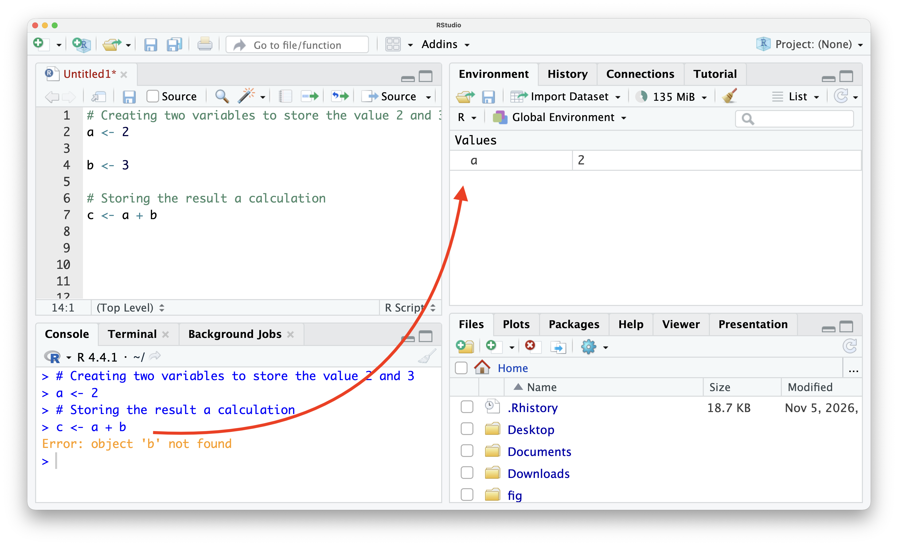

# Debugging {#sec-debugging}



::: {style="margin-top: 1em; font-size: 125%; font-weight: 1000; text-align: center;"}
Soa lavo, hahay hamindra!
:::

Studies on software quality show that industry-standard code contains 10 to 50 bugs per 1,000 lines of written code. This means about one error every 20 to 67 lines. Thus, even professionally trained programmers make mistakes. As the proverb says: "Mihinam-bary aza misy latsaka"

Bugs are inevitable at any skill level. For most readers, bugs are primarily execution errors in code. The emotional dissonance between expecting final results and receiving a rejection message from the program can make encountering an error feel crushing.

Bugs made by beginner programmers and software engineers are not of the same nature. Most bugs created by beginners can be circumvented through the proper use of an IDE (@sec-ide) and better grasp of the basic principles, whereas advanced programmers rely on debugging tools (also included in IDEs). However, software engineers were also beginner programmers once. As with any learning process, the initial phase is the hardest and slowest, following the lag phase of exponential growth (@sec-exponential). While encountering a bug is annoying, debugging can also be enjoyable—much like solving a puzzle.

## Formal {.unnumbered}

A **bug** is an error, flaw, or fault in a computer program that causes it to produce an incorrect, unexpected, or unintended result. Bugs can stem from syntactic mistakes (such as typos or missing parentheses), semantic issues (such as passing an incorrect data type to an argument), or logical errors (where the code executes without failing but returns mathematically or conceptually incorrect output).

**Debugging** is the systematic process of identifying, isolating, and resolving bugs within software code. It involves analyzing error messages, stepping through code execution line by line, inspecting variable values in the working environment, and testing fixes to ensure the program behaves strictly as intended.

## Examples {.unnumbered}
1. Object not found: Typo in the variable name

```{r}
#| echo: true
#| error: true

# Define a numeric variable storing the value 1
variable1 <- 1

# Square variable1, resulting in an error due to a typo (varable1)
variable_squared <- varable1^2

```

2. Object not found: Some preceding lines were not executed. As seen in the error message, the object `b`{.r} is not found. Indeed, inspecting the environment reveals that no object `b`{.r} was created. A closer inspection of the console history shows that the execution skipped line b and ran a followed directly by `c <- a + b`{.r}.

{#fig-bugNonEvaluated}

3. Improper argument: The error below is caused by a type mismatch: the value is stored as a character string rather than a numeric value, whereas the argument for `sin()`{.r} must be of numeric type.

```{r}
#| echo: true
#| error: true

# Storing a value 1
value <- "1"

# Taking the sine
sin(value)
```

4. Structural problem: Below, a matrix multiplication (@sec-matrixMultiplicationMath @sec-matrixOperationCoding) fails because the matrix dimension requirements are not satisfied.

```{r}
#| echo: true
#| error: true

# # Define a matrix representing the quantity of fruit purchased per person (4 rows, 3 columns)
mat <-
    matrix(c(6, 3, 0, 1, 3, 1, 10, 0, 0.5, 0, 0, 2),
    nrow = 4,
    ncol = 3)
mat

# Define a numeric vector representing the price of 4 fruit items
price <- c(500, 1000, 2000, 600)

# Expenditure per person (fails because inner dimensions 4x3 and 4x1 do not conform)
mat %*% price
```

## Tips and warnings {.unnumbered}

- "You made a mistake." For beginner and even intermediate coders, encountering an error message often causes frustration, leading to blaming the program. However, it is usually a human mistake.

- It is often easier to spot errors in someone else's code than in one's own. This makes sense and applies to everyday life as well. If stuck, stepping away for a while allows one to return to the code with a fresh perspective.

- Read the error message carefully and attempt to understand it. With sufficient repetition and practice, the source of an error becomes obvious.

- Run the code line by line. Identifying an error when executing multiple lines at once is difficult; running code sequentially makes it easier to pinpoint where the issue occurred.

-  Every time a function is called, ensure the required arguments, argument data types, and expected output types are clearly understood.

- IDEs (@sec-ide) are powerful tools that help prevent simple mistakes:
  - Auto-suggestion: Once a variable or function exists in the workspace, typing the full name manually is unnecessary.
  - Auto-completion of parentheses to prevent mismatched brackets.
  - Real-time syntax checking to flag simple typos instantaneously.
  - Additional helper features.

- Warnings are not errors. They may sometimes be safely ignored, but they can also indicate underlying issues that cause problems in subsequent lines.

- The absence of an error message does not guarantee that the code is behaving as intended.

- Actual bugs within R or R packages can occur, but such claims must be supported with reproducible evidence before reporting them to developers.

