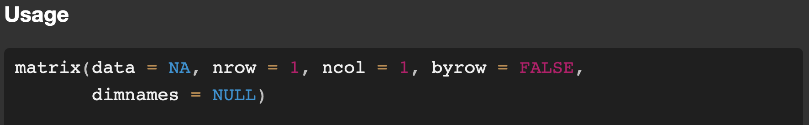

# Function {#sec-functionCoding}



::: {style="margin-top: 1em; font-size: 125%; font-weight: 1000; text-align: center;"}
More than 4 250 functions and 25 000 CRAN packages
:::

Function is another term that is borrowed from plain language and also mathematical language. In this case, a function in programming can be seen as a generalization of functions in mathematics @sec-functionMath. And that generalization is good thing because it is what makes programming so useful and powerful.

In R, a function can be a simple mathematical functions (like `sin(), cos(), exp(), log()`{.r}). It could be a constructor like `c(), matrix(), list()`{.r}, and a statistical function like `mean()`{.r} to compute the mean and many more. As you could guess, a function exists for most statistical test one wants to do, to plot figures, manipulate data, solve equations, and imagination is the limit.

Once we install and run R, there are roughly 4250 functions that are ready to use. But because that is not sufficient for everyone's need, more functions are created. Packages are essentially a collection of functions that perform a specific task popular examples are `ggplot2` for making figures or `vegan` for community analyses. Packages are there to make one's life easier. And one of the strengh of R is that there are many packages. While there is no estimates of how many functions are "official", with say 15 functions per packages there are at least `r format(4250 + 25000 * 15, scientific = FALSE)` functions.

Functions are there to help, but functions are also the foes..how to locate the function you need, how to use a function (especially how to read the output) and why on earth it throws an error?

## Formal {.unnumbered}

Here is how a function is constructed and the convention is that it is always lowercase.

```r

function_name <- function(argument1, argument2 = TRUE, ...){
    "Whatever the function does with those argument"
    return(output)
}

```
There are several key points

- Function name: this is similar to giving a variable name @sec-assignment
- After the assignment operator, function explicitly say that the object created is a function
- Within the parentheses are the arguments separated by comma
- The block code that what the function is doing
- And the ouput within the


Explicit and implicit argument


## Examples {.unnumbered}

- Mathematical function
Here are examples of basic function
```{r}
#| echo: true

# calculate the sinus of 1
sin(1)

# calculate the absolute value
abs(-2)

# calculate the square root of 25
sqrt(25)

# you can also store the result using assignment
result <- sqrt(25) + abs(-2)

```

- Data manipulation and construction

```r
    sort()
    unique()
    seq()
```

- Plot function


## Tips and warnings {.unnumbered}
- Semantic: arguments, input, parameters.
- CRAN packages:
- Open source you can find the exact body of the function

###  Implicity and explicit argument: example matrix construction
And here is what happens when we look for definition of `matrix`{.r} in the help file

{#fig-matrixHelp}.

There are for expecit argument, data, nrow, ncol, and byrow

  - Explicit: adding the argument name in the function
```{r}
#| echo: true
mat <-
    matrix(data = c(6, 1, 0, 3, 10, 1, 0, 0.5, 0, 3, 0, 2),
    nrow = 4,
    ncol = 3,
    byrow = FALSE)
mat
```

```{r}
#| echo: true
mat <-
    matrix(
        byrow = FALSE,
        ncol = 3,
        data = c(6, 1, 0, 3, 10, 1, 0, 0.5, 0, 3, 0, 2),
        nrow = 4
    )
mat
```
In hear by adding the argument name, the order of appearance does not matter
- Implicit: the argument are implied
```{r}
#| echo: true
mat <-
    matrix(c(6, 1, 0, 3, 10, 1, 0, 0.5, 0, 3, 0, 2), 4, 3, FALSE)
mat
```
 What happen in the explicit is that argument are intepreted in the order they are used. Many functions are like this but can be tricky.
 - Different matrix if argument swapped
```{r}
#| echo: true
mat <-
    matrix(
        c(6, 1, 0, 3, 10, 1, 0, 0.5, 0, 3, 0, 2), 3, 4, FALSE)
mat
```
- Or even an error
```{r}
#| echo: true
mat <-
    matrix(
        c(6, 1, 0, 3, 10, 1, 0, 0.5, 0, 3, 0, 2), 3, 4, FALSE)
mat
```

The rule is data is first to can be omitted but the other arguments can be tricky.

### Default

 - all defined
```{r}
#| echo: true
mat <-
    matrix(data = c(6, 1, 0, 3, 10, 1, 0, 0.5, 0, 3, 0, 2),
    nrow = 4,
    ncol = 3,
    byrow = FALSE)
mat
```

- Other arguments omitted, so computer use the default. ncol is not defined so inferred from lenght of the vector and nrow. The default is binary is FALSE.

```{r}
#| echo: true
mat <-
    matrix(data = c(6, 1, 0, 3, 10, 1, 0, 0.5, 0, 3, 0, 2),
    nrow = 4)
mat
```

- If one wants to make a plot, there is over 20 arguments you can add. Default is there so you don't need to specify all of them. So most of the argument are assigned with a  default value eg. color, point size etc.

### Last but not least


- Meta understanding of function that could help
  - What do you want to do?
  - What is the name of the function?
  - What is your argument of that function
  - What is the output of that function

Example 1:
 - I want to calculate the sinus of a number
 - The sytnax that calls the function sinus is sin()
 - The argument should be a number
 - The output should also be a number.


Example 3:
 - I want to do a linear regression between of height and altitude
 - The syntax is lm(height ~ altitude)
 - The argument should be two vectors of same length
 - The output is a list of a bunch of things including the coefficient, p-value, R-squared, residuals etc.

A good idea to The arguments are there and the values. It is the same for all help file in R.

