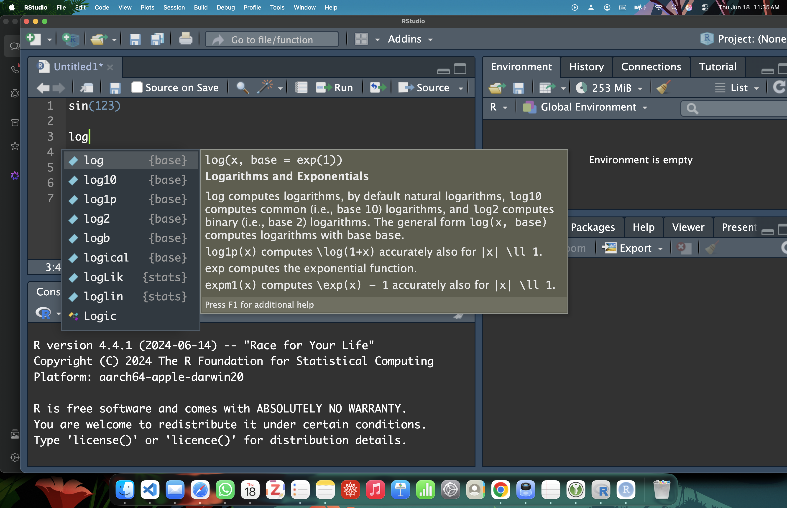

# IDE: Integrated Development Enviroment {#sec-ide}



## Concepts and intuitions {.unnumbered}
Open RStudio!

{#fig-RStudio fig-alt="alt"}

The first is to open RStudio, and you see four windows, what are these and what to they mean?
For our purpose, we just focus on the two on the left: the script (on top) and the console (at the bottom).

In the previous chapter @sec-console, console and a keyboard is all you need to communicate with the program: write, read, evaluate, print output. That is the primitive way to interact with all programs.

The recommended practice is not to write the prompt/code in the console, except for basic arithmetic and one line. The console is not designed for code writing. Codes are written in a separate window called the script editor.

To improve coding, the script editor has been infused with more feature: autocompletion and suggestion, syntax highlighting and formatting.

{#fig-completion fig-alt="alt"}

And most importantly, you can save you code (same as saving a word doc or alike). And open it.

**Evaluating your code**
In a basic way, the user can then select which part of the code they want to evaluate, copy it to the console, and then evaluate.
But copy/paste is also slow, and there was an added feature of the script: send the code to the console while staying in the script window.

Once your code is ready, you can select the part you want to evaluate and press command + return or click run bottom and the code will be read in the console, evaluated and printed.

**What is an IDE?**
IDE is a program that is built on top of the native program (like R), that faciliates use of R.
There are many IDE such as RStudio, VS Code, Sublime Text, etc. However RStudio is the most popular IDE for R.
Unlike the other that integrate other programming language.
RStudio is a dedicated IDE that is meant work with R.
Because it is a R specialist, it includes many useful features, and why the most popular and adopted by many.
Furthermore, it is free!

## Formal {.unnumbered}

## Examples {.unnumbered}
{#fig-dark_theme fig-alt="alt"}

## Tips and warnings {.unnumbered}
- Shortcut!
- Which code chunk are sent to be execute.
- IDE and formating and autocompletion.
- bash (there is another way through bash but we will not address that for the moment).
- Change appearance

## If you want to know more {.unnumbered}
There are tons of features, we stick to the basic here but

[Documentation for RStudio](https://docs.posit.co/ide/user/)
