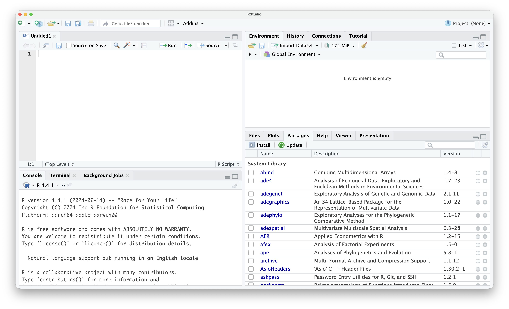
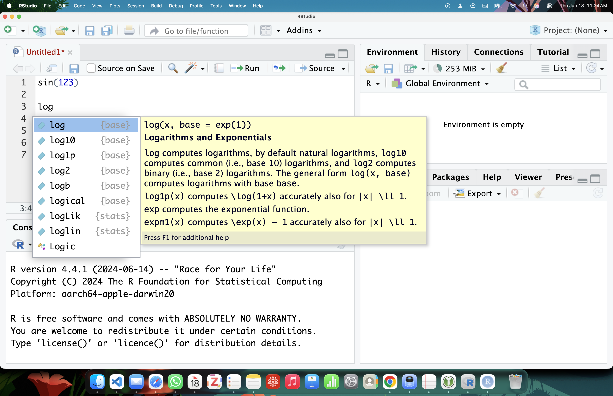
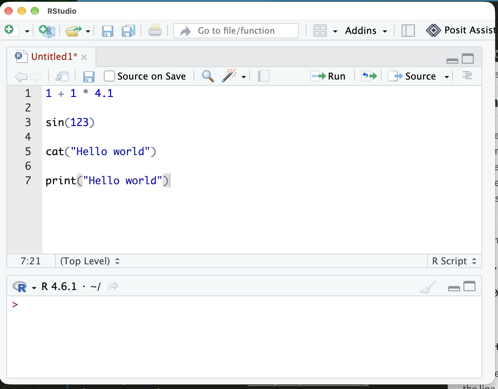
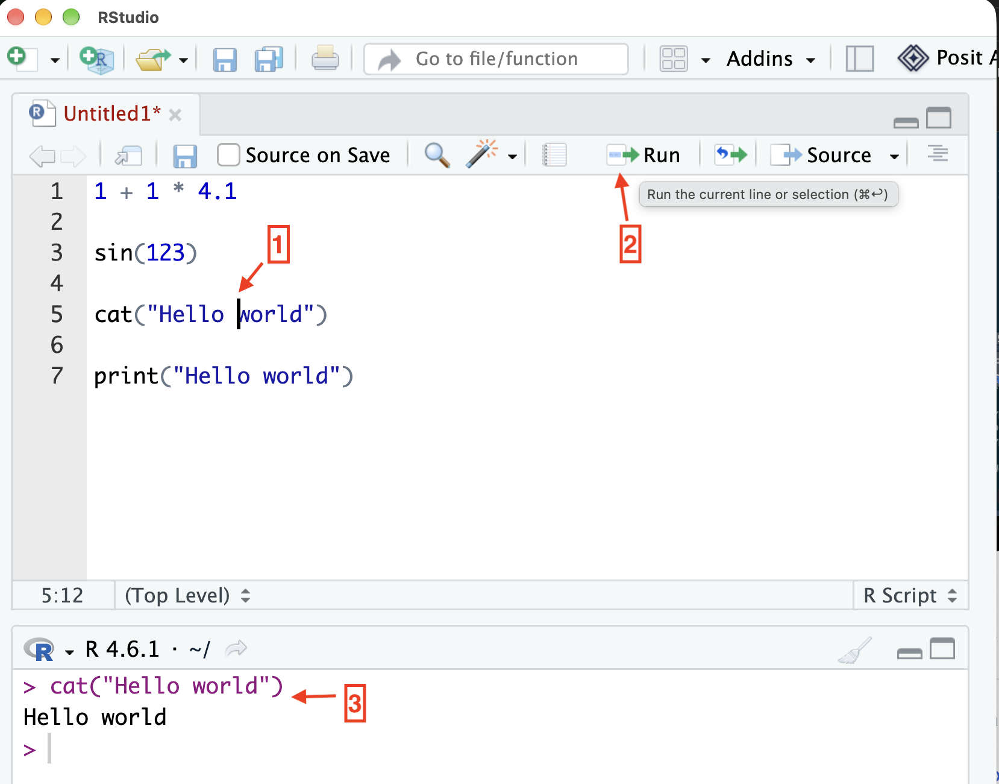
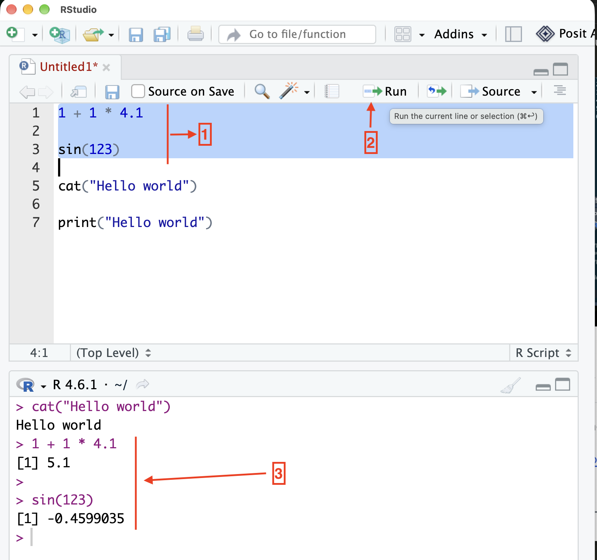
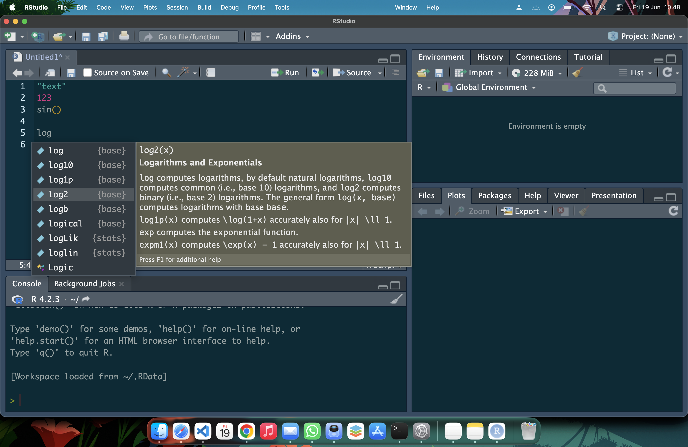

# IDE: Integrated Development Enviroment {#sec-ide}



::: {style="margin-top: 1em; font-size: 125%; font-weight: 1000; text-align: center;"}
Open RStudio!
:::

{#fig-RStudio}

Open RStudio: this exciting step when one wants to learn to code in R.
The default RStudio contains four windows: *script editor/Source* on top-left, *Console* and other tabs on the bottom-left , *Environment* and other tabs at the top-right, and *Plots* and other tabs at bottom-right.
For our purpose, we will focus on the two on the left: the script editor and the console.

In the previous chapter @sec-console, tconsole and a keyboard is all you need to communicate with the program: write, (read,) evaluate, print output. That is the primitive way to interact with all programs.

The recommended practice is **NOT** to write the prompt/code in the console. The console is not designed for code writing. Codes are written in a separate window aptly called the script editor.

The script editor is simply a separate window that helps you to write a code. Unlike the console, you save your code which then allows you to open and edit it in the future. Similar to saving any file.

A script editor is infused with various features to facilitate coding and improve productivity @fig-completion.

{#fig-completion}

**Syntax highlighting**: the type of object have different color. Text,number, function sinus are displayed differently

**Autocompletion**: when you open a right parenthesis, it automatically add the closing one. In fact it works with square bracket [] and curly brackets {}.

**Suggestion**: you type the first few letters and it suggests based on the words present in its memory. This is a faster than typing the whole text which are prone to typos.

**Evaluating your code**: You can send your code to the console by typing command + enter or windows + enter. What it does is sort of: copy pase the selected code after >, and then evaluate and print it.

**Save and close**: you can save you code (like saving everytiing else). Close, and open in the future, and run. This is a great assest for sharing and reproducibility.

RStudio is the most popular IDE for R

## Formal {.unnumbered}

IDE: Integrated Development Environment is a software that is built on top of the native program (like R), that faciliates use of R.
There are many IDE such as RStudio, VS Code, Sublime Text, etc.
RStudio is a dedicated IDE that is meant work with R.
Unlike the other that integrate other programming language.
Because it is a R specialist, it includes many useful features, and why the most popular and adopted by many.
Furthermore, it is free!

SIRI:

An IDE, or Integrated Development Environment, is a comprehensive software application that provides programmers with all the essential tools they need to write, test, and debug code in one place. Using RStudio as a main example, an IDE acts as a digital workbench that wraps around the basic R Console, adding a text editor, a file manager, and visual panels to make coding much more efficient.
If the R Console is the engine of a car, an IDE like RStudio is the dashboard, steering wheel, and interior that actually allows you to drive it comfortably.
CORE COMPONENTS OF AN IDE (THE RSTUDIO LAYOUT)
RStudio perfectly illustrates the four standard panes of a modern IDE:
The Source Editor (Top Left): This is where you write and save your actual R scripts. Unlike the console, code here doesn't run until you tell it to. The editor features syntax highlighting (coloring your code to make it readable) and auto-completion (suggesting function names as you type).
The R Console (Bottom Left): This is the standard interactive console embedded directly into the application. When you run code from your editor, it is automatically sent here to be executed.
The Environment/History Pane (Top Right): This acts as your workspace memory. It shows a list of every variable, data frame, and function you currently have loaded, so you never have to guess what data you are working with.
The Files/Plots/Packages Pane (Bottom Right): A multi-tool area where you can browse your computer's folders, view the charts and graphs you generate, and manage installed packages.
WHY USE AN IDE?
Without an IDE, you would have to write your code in a separate text editor (like Notepad), copy and paste it into the R Console to run it, and open a separate image viewer to see your plots. An IDE brings all of these actions into a single, unified window.

GEMini:
An **IDE** (**Integrated Development Environment**) is a single software application that combines all the essential tools a developer or data scientist needs into one unified interface.

Instead of writing code in a basic text editor, executing it in a separate terminal, and opening another window to view graphs, an IDE consolidates these workflow components under a single workspace.

---

### Key Components of an IDE (Using RStudio as the Example)

An IDE is defined by four core building blocks working seamlessly together. In RStudio, these map directly to its signature **4-pane layout**:

| IDE Core Capability | What It Does | RStudio's Pane Implementation |
| --- | --- | --- |
| **1. Source Code Editor** | Text editing with syntax highlighting, auto-completion, line numbers, and error checking. | **Source Pane (Top-Left):** Where you write and save reproducible `.R`, `.Rmd` (R Markdown), or `.qmd` (Quarto) scripts. |
| **2. Interactive Runtime / Engine** | Executes code dynamically and displays output or immediate execution feedback. | **Console Pane (Bottom-Left):** The active R console prompt (`>`) where code is evaluated line-by-line. |
| **3. Workspace & Memory Inspector** | Shows variables, loaded data frames, functions, and session state currently held in RAM. | **Environment / History Pane (Top-Right):** Displays loaded datasets, vectors, memory usage, and Git version control tools. |
| **4. Output Viewer & File Manager** | Renders visual assets, documentation, file directory structures, and installed package lists. | **Plots / Files / Help / Packages Pane (Bottom-Right):** Renders generated charts, browses project directories, and displays function documentation. |

---

### Text Editor vs. R Console vs. IDE

To understand the definition of an IDE, compare how code execution works across different tool tiers:

* **Basic Text Editor (e.g., Notepad):** Just plain text editing. It cannot run code or inspect variables.
* **Bare R Console:** Evaluates code immediately line-by-line, but doesn't save scripts, visualize memory, or provide advanced project management.
* **RStudio (IDE):** Combines the editor, console, variable viewer, plot window, debugger, package installer, and version control (Git) into one coordinated program.

## Examples {.unnumbered}

Step 1: One can write all the codes in one file

{#fig-simple_script}

Step 2: evaluate. Two ways to evaluate: Click on the icon run after placing the cursor in the line

 - line evaluation here place the cursor in line 5 not where in the line.
{#fig-oneline}

- selection evaluation: select the code chunk
{#fig-selection}

## Tips and warnings {.unnumbered}
- A script editor is just a text editor, one can write is notepad or something alike and save it. One can just cope the script and paste it in the console. But it is slow..hence the use of IDE. The automation of sending it to the console.
- R also have a native script editor, you can create that like you create a new document for MS Word
- Clicking is slow, typing is fast...instead of clikcing the icon, the shortcut is control + enter. After few uses you will not notice that like control + S to save, control + A to select all.
- What about the other two windows: these are additional functionality. Like if you make a figure it will show on the window on the bottom left. The R enviroment shows all the object your created @sec-assignment
- Change appearance and customization. There is something called: Global option with cmd +, or windows + ,. You can customize anything, font size, color, syntax highlighting, rearrange pane etc. There pre-defined themes @fig-dark_theme.

{#fig-dark_theme}

- [Documentation for RStudio](https://docs.posit.co/ide/user/)
