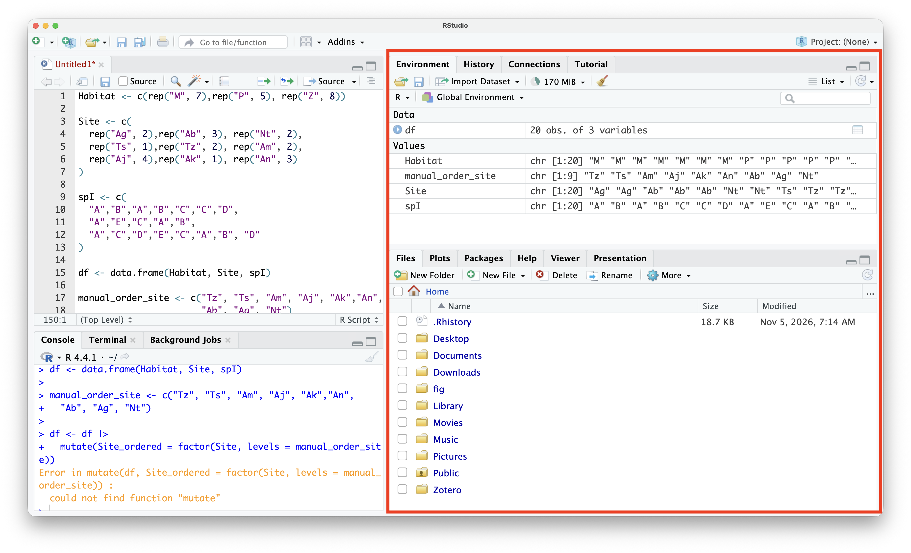

# IDE: Integrated Development Environment {#sec-ide}



::: {style="margin-top: 1em; font-size: 125%; font-weight: 1000; text-align: center;"}
Secrétaire, comptable, avocat(e) personel(le)
:::

A common, innocent, and inconsequential mistake is to confuse R and RStudio. R is a programming language, whereas RStudio is a specialized IDE for R.

In the previous chapters, a console (@sec-console) was presented as the minimal component needed to code—the interface between the human and the computer. As more is written, script editors assist the process of code writing (@sec-script) (like having a personal assistant to assist with tasks). An IDE is the final stage of making coding more comfortable.

To use a metaphor: R is the car, a script editor is a set of accessories (steering wheel cover, leather seats, backup camera, etc.), and an IDE is a combination of an auto shop, a garage, and a co-pilot.

RStudio is the most popular IDE for R.

## Formal {.unnumbered}

An IDE, or Integrated Development Environment, is a single software application that combines the essential tools needed to write, test, and debug code in one unified interface. Using RStudio as a main example, an IDE wraps around the basics:

- R Console: command-line interface (@sec-console)
- Script editor called Source: a script editor (@sec-script)
- Environment and history: saves history, created objects (@sec-variable), and more
- Output: generates figures and more

{#fig-RStudio}

Instead of writing code in a basic text editor, executing it in a separate terminal, and opening another window to view graphs, an IDE consolidates these workflow components under a single workspace.

## Examples {.unnumbered}

Step 1: Write the code in the script editor

{#fig-simple_script}

Step 2: Execute the code: selecting the code (1) and clicking Run (2) sends the code to the console, evaluating it and printing the results in the console (3)

- Executing one line of code: place the cursor anywhere on line 5 (it does not need to be at the beginning or the end)

  {#fig-oneline}

- Executing a block of code: select the lines to evaluate and click Run

  {#fig-selection}

## Tips and warnings {.unnumbered}
- The native R GUI is improving. It includes a script editor, native code execution, a package manager, and other features. Comparing the two can be instructive.

- While RStudio is a powerful IDE, it is heavy and may experience performance or memory issues, especially on older computers. In emergencies, the native R GUI serves as a reliable alternative.

- Underused Environment tab/pane: This lists all objects created during an R session. It is quite useful for keeping track of created objects and taking a quick look at their values.

- Friendly bottom-right pane: While coding primarily involves typing, this pane allows the use of natural mouse clicks to navigate folders, import files, install and load packages, search for documentation, and more.

{#fig-RStudioEnvironment}

- [Documentation for RStudio](https://docs.posit.co/ide/user/)

- Positron may be the next evolution of RStudio, especially for those who also code in Python.
