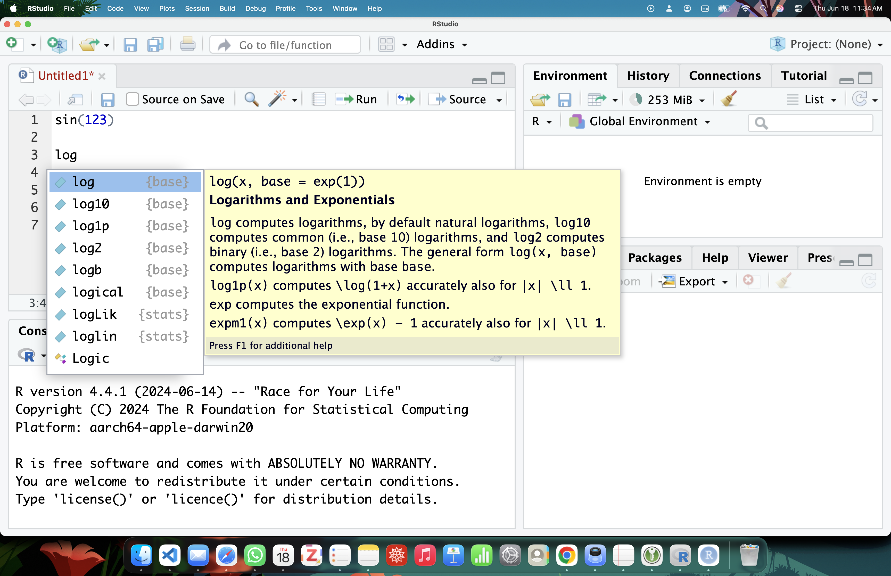

# Script editor {#sec-script}



::: {style="margin-top: 1em; font-size: 125%; font-weight: 1000; text-align: center;"}
Secretaire personel
:::

If you are reading this handbook, it is almost sure that you were, are, and will use R. In which case, you will have to write, copy, edit, delete lines and lines of codes. With such a intensive task, it is wise to make the experience  as pleasant, productive, and efficient as possible.

The essence of a script editor is to assist the coders in all possible way. The most basic script editor available is just an text editor (e.g. Notepad). Yes, it is a script editor because it allows one to write, edit, and save codes. In fact, in the early days of R, ecologists wrote code on Notepad, and latter Notepad++. Then copy the chuncks to execute into the console (@sec-console).

Nowadays, there are many script editors available, but the majority people are using a stript editor that comes with the IDE (@sec-ide). To make it more concrete here are few basic features that enhance code writing:

**Line numbering**: gives a coordinates to the code. For instance, one can just say there is an error in line 424. identifies exact lines when errors occur

**Identation**: automatically indent the code when hierarchy is detected.So code structure is easy to scan

**Syntax highlighting**: different colors for different objects: number (@sec-numeric), text (@sec-character), functions (@sec-functionCoding), and comments. So code structure is easy to scan

**Bracket & Parenthesis Matching**: Highlights corresponding opening and closing brackets (), {}, [] to prevent syntax errors.

There might be different secretary, suits your need to choose the functionality you need. A programmer codes in many languages like Python, java, and R might opt for a multi-language script editors. While the for the average R user, the script editor that comes with RStudio is the most popular choice.

## Formal {.unnumbered}
A script editor is a specialized text interface used by programmers to write, edit, and save code files. Unlike an interactive console (@sec-console) that runs code immediately line-by-line, a script editor allows you to write out a full sequence of instructions, review them, and save them as a permanent file before running them.

## Examples {.unnumbered}

- A code look in basic text editor without syntax highlighting and indentation


```plain
# Add one plus one
1 + 1

# Import your data into R
data <- read.csv('my_data.csv')

# A ggplot code
ggplot(data, aes(x = age, y = height)) +
geom_point()+
theme_bw()

```

- The same code with syntax highlighing different type of object Comment in gray, numbers (@sec-numeric) in red, function (@sec-functionCoding) is in blue, and character (@sec-character) and variable (@sec-assignment) in black.

```r
# Add one plus one
1 + 1

# Import your data into R
data <- read.csv(“my_data.csv”)


# A ggplot code
ggplot(data, aes(x = age, y = height)) +
    geom_point()+
    theme_bw()

```

- A script editor is infused with various features to facilitate coding and improve productivity. Here is an example where it will suggest/auto-complete the code @fig-completion.

{#fig-completion}


## Tips and warnings {.unnumbered}
- Semantic: code vs script vs program vs commands. It is essentially means the collection of instructions that you want the programs to evaluate
- **DO NOT** write codes in console unless it is a one time check.
- Document your code: a good habit yet easy to ignore is to add human. While codes are, other people and yourself could benefit from verbale description. This is called comment (see gray part preceeded by # above). Practically, it is ignored during the evlation by the computer.
- An underused feature of script editors are shortcuts. It is a good habit to explore what are available. For instance, shortcut for variable assignment `<-` this is for instance very useful when some symbols are not easily accessible on the keyboard. In fact, you can even create your own shortcut. Clicking is slow, typing is fast...instead of clikcing the icon, the shortcut is control + enter. After few uses you will not notice that like control + S to save, control + A to select all.
- Embarce the power: most script editor you will choose are more powerful than you think. It could be fun to read and learn some features that will make your coding more productive.
- By definition, a script is meant for code writing. To evaluate in the console, the brute force is to copy the chunks one wants to run. However, there are now features that allows to send the code the console while staying the script editor. This is through IDE @sec-ide.
- Raw format: codes are written in a raw format. It could opened even in word. The syntax are features of the script editor and not the file and not the file (unlike word document with bold etc).
- Because it is a raw file is that it could be tracked with a version control program.
- Everyone loves to play with the theme. Like a screen shot it is ea but can . Themes could be light, dark, colors could be bright, etc.
