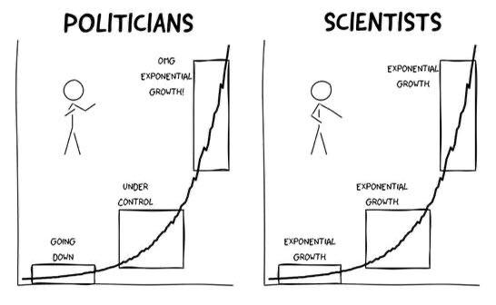

# Exponential function {#sec-exponential}


::: {style="margin-top: 1em; font-size: 125%; font-weight: 1000; text-align: center;"}
$e \approx 2.718 \ldots$
:::


Multiplication is fundamentally condensed addition (e.g., $2 + 2 + 2 = 3 \times 2$), while exponents represent condensed multiplication (e.g., $2 \times 2 \times 2 = 2^3$; see @sec-matrixOperationMath). With these knowledge, exponent rules can be derived logically rather than memorized by heart. For example:

$$a^n \times a^m = a^{n+m}$$

For instance:
$$2^3 \times 2^4 = (2 \times 2 \times 2) \times (2 \times 2 \times 2 \times 2) = 2^7$$


At the end of highschool, a specific continuous function is introduced: the exponential function, written as $\exp(x)$ or $e^x$. Alongside concepts like limits and derivatives, its most fundamental algebraic property is:

$$e^x \times e^y = e^{x+y}$$

In hindsight, this is identical to the traditional product rule for exponents, replacing the generic base $a$ with the specific constant $e \approx 2.718\dots$.

Many key properties flow naturally from this connection without requiring brute-force memorization:

- Zero Exponent ($e^0 = 1$): Just as $a^0 = 1$ for any non-zero number, raising $e$ to zero yields 1.
- Strict Positivity ($e^x > 0$): Powers of positive bases are strictly positive across all real numbers $\mathbb{R}$—just as $2^n$ can never yield a negative value for any real exponent $n$, $e^x$ remains strictly positive for all $x$.
- Negative exponent: $e^-x = \frac{1}{e^x} as $2^{-1} = \frac{1}{2}$.

Why is this specific constant $e \approx 2.718\dots$ so special? Why not use $\pi^x$ or another base? While entire volumes are dedicated to Euler's number $e$, the short answer is that $e$ emerges naturally throughout mathematics and science due to its unique properties.

## Formal {.unnumbered}

The function $\exp(x)$ or $e^x$ can be defined by the infinite sum:
$$
    \exp(x) = \sum_{n=0}^{\infty} \frac{x^n}{n!}
$${#eq-eTaylor}
see @sec-sum for summation notation.

Using this definition, the mathematical constant $e$ is formally defined as the evaluation of this series at $x=1$:
$$
    e = \exp(1) = \sum_{n=0}^{\infty} \frac{1}{n!}
$${#eq-e1}

Below is the graphical representation of with a few general properties positive and increasing
```{r}
#| label: fig-expFunction
#| fig-cap: "The exponential function f(x) = e^x highlighting key reference points at x = 0 and x = 1"
#| fig-width: 6
#| fig-height: 4.2

# 1. Setup canvas styling
par(mar = c(4.5, 4.5, 2, 2), mgp = c(2.5, 0.7, 0))

# 2. Generate values
x <- seq(-2, 2, by = 0.01)
y <- exp(x)

# 3. Base Plot
plot(x, y,
     type = "l",
     lwd = 2.5,
     col = "#1f77b4",
     xlab = "x",
     ylab = expression(f(x) == e^x),
     xlim = c(-2, 2),
     ylim = c(0, 8),
     las = 1,
     xaxs = "i",
     yaxs = "i",
     axes = FALSE)

# Custom crisp axes
axis(1, at = seq(-2, 2, by = 1))
axis(2, at = seq(0, 8, by = 2), las = 1)
box(bty = "l", col = "gray40")

# Background grid & axis baselines
grid(col = "gray92", lty = "solid")
abline(h = 0, col = "gray60", lwd = 1)

# Re-draw line over grid
lines(x, y, lwd = 2.5, col = "#1f77b4")

# 4. Highlight key points (x = 0, x = 1)
x_pts <- c(0, 1)
y_pts <- exp(x_pts)

# Dashed projection lines to axes
segments(x_pts, 0, x_pts, y_pts, lty = 2, col = "#d62728", lwd = 1.2)
segments(-2, y_pts, x_pts, y_pts, lty = 2, col = "#d62728", lwd = 1.2)

# Point markers
points(x_pts, y_pts, pch = 19, col = "#d62728", cex = 1.3)

# Point labels
text(0, exp(0) + 0.45,
     labels = expression(group("(", list(0, 1), ")")),
     pos = 2, col = "#d62728", cex = 0.95)

text(1, exp(1),
     labels = expression(group("(", list(1, italic(e)), ")") %=>% paste("(", 1, ", ", 2.718, ")")),
     pos = 4, col = "#d62728", cex = 0.95)
```

## Examples {.unnumbered}

- The exponential function plays a central role in probability and statistics, most notably forming the core of the Gaussian density curve (@eq-gaussian):
$$
    f(x) = \frac{1}{\sigma \sqrt{2\pi}} e^{\displaystyle -\frac{(x - \mu)^2}{2\sigma^2}}
$${#eq-gaussian}

- If a component (such as a car part) has a constant failure rate $\lambda$, its cumulative probability of failure by time $t$ is modeled by the exponential function^[called cumulative distribution function]:
$$
1 - e^{- \lambda t}
$${#eq-failure}
Notice that at $t = 0$, the probability of failure is $1 - e^0 = 0$, and as time $ t\rightarrow \infty$, the term $e^{- \lambda t} = \frac{1}{e^{\lambda t}} \rightarrow 0$. The probability approaches to 1 meaning things are meant to break.

- An unexpected yet fundamental appearance of $e$ arises from continuous growth^[In finance, this expression represents the limit of compounding interest as the compounding frequency n approaches infinity]:
$$
    \lim_{n \to \infty } (1 + \frac{1}{n})^n = e
$${#eq-eCompound}

- The intrinsic growth $r$ in ecology is the solution the Euler-Lotka equation
  $$
    1 = \int_0^{\infty} e^{-r x} l(x) m(x) dx
  $${#eq-EulerLotka}
where $x$ is age, $l(x)$ is the probabily that a new born survives to age $x$, and $m(x)$ is the average number of offspring produced by an individual at stage x

## Tips and warnings {.unnumbered}

- The number $e$ is the unique base whose exponential function serves as its own derivative:

$$\frac{d}{dx}e^x = e^x$$

Equivalently, $y = \exp(x)$ is the fundamental solution to the ordinary differential equation (@sec-differential):

$$\frac{dy}{dx} = y \quad \text{with initial condition } y(0) = 1$$

This  property means that at any point along the curve $y = e^x$, the height of the function above the horizontal axis is exactly equal to the slope of its tangent line.

<!--
- We can derive the derivative of exp(x) from @eq-eTaylor,

$$
\frac{d}{dx} \frac{x^n}{n!} = n \frac{x^{n-1}}{n!} =  n \frac{x^{n-1}}{n \times (n-1)!} = \frac{x^{n-1}}{n-1}
$$ -->

- The exponential function $e^x$ is the reciprocal of the logarithm function $\ln(x)$.

$$
    e^{\displaystyle \ln(\text{input})} = \text{input} = \ln(e^{\displaystyle \text{input}})
$${#eq-eLog}

This relationship is characterized with the visual symmetry between the two curves with respect to the identidy function $y = x$ .

```{r}
#| label: fig-exp-log-inverse
#| fig-cap: "Geometric reflection of exp(x) and ln(x) across the identity line y = x"
#| fig-width: 5.5
#| fig-height: 5.5

par(mar = c(4, 4, 1, 1), mgp = c(2.3, 0.7, 0))

x_pos <- seq(0.05, 3.2, length.out = 500)
x_all <- seq(-3, 3.2, length.out = 500)

y_exp <- exp(x_all)
y_log <- log(x_pos)

plot(NA, xlim = c(-3, 3.5), ylim = c(-3, 3.5),
     xlab = "Input", ylab = "Output", las = 1, asp = 1, axes = FALSE)

axis(1, at = -3:3)
axis(2, at = -3:3, las = 1)
box(bty = "l", col = "gray40")
grid(col = "gray90", lty = "solid")

# Symmetry axis y = x
abline(a = 0, b = 1, lty = 2, col = "gray50", lwd = 1.5)

# Curves
lines(x_all, y_exp, col = "#1f77b4", lwd = 2.5) # exp(x)
lines(x_pos, y_log, col = "#2ca02c", lwd = 2.5) # ln(x)

# Inverse pairs
points(c(0, 1), c(1, exp(1)), pch = 19, col = "#1f77b4", cex = 1.2)
points(c(1, exp(1)), c(0, 1), pch = 19, col = "#2ca02c", cex = 1.2)

# Connector lines showing reflection
segments(0, 1, 1, 0, lty = 3, col = "#d62728")
segments(1, exp(1), exp(1), 1, lty = 3, col = "#d62728")

# Labels
text(0.5, 2.5, expression(f(x) == e^x), col = "#1f77b4", cex = 1.1)
text(2.5, 0.4, expression(g(x) == ln(x)), col = "#2ca02c", cex = 1.1)
text(2.2, 2.5, "y = x", col = "gray40", cex = 0.95)
```

- Exponential growth is a phenomenon that deeply concerns scientists, yet non-scientists frequently overlook its early stages. Because the initial rate of increase appears slow and linear, the curve hides its explosive potential until it reaches a sudden, compounding inflection point.
{#fig-exponentialCovid}

### Notations/Semantic/Terminology

The exponential operation can be written in two distinct notations, each offering unique pedagogical and structural advantages depending on the context:

- Writing $e^x$ directly emphasizes the algebraic concept of repeated base multiplication and continuous growth. Visually, it connects back to elementary exponent rules ($a^b$), making properties like $e^a \cdot e^b = e^{a+b}$ and $e^0 = 1$ immediately recognizable and intuitive to read.

- The functional notation $\exp(x)$ is preferred in advanced applied mathematics and programming for several key reasons:
  - Readability of Complex Exponents: When the exponent consists of fractions, derivatives, or multi-variable terms—such as the Gaussian distribution or exponential decay—writing $e^{\dots}$ forces tiny inline script fonts that are difficult to read. Functional notation $\exp(\dots)$ keeps the argument at full display size on the main text baseline.
  - Functional Identity: It reinforces that the exponential is a mathematical operator (mapping inputs $x \to y$) rather than simple fixed-base arithmetic.
  - Syntax Alignment: It matches the universal function syntax used across programming environments and computer algebra systems (such as `exp(x)` in R, Python, most programming language)